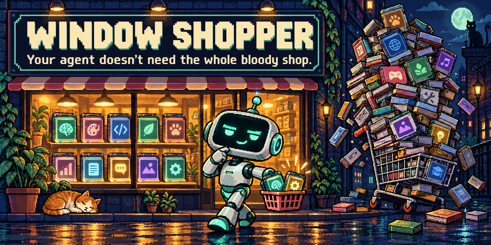

<p align="center">
  
</p>

# Window Shopper

**Your agent doesn't need the whole bloody shop.**

[](https://github.com/grym3s/window-shopper/actions/workflows/test.yml)

[](LICENSE)

Give your agent a skill library. Let it take a small basket.

Window Shopper searches installed skill descriptions, selects relevant instructions
within a budget, and checks the selection before loading. Built for people running
local models who want control over what enters their context window.

**Offline. Standard-library Python. No API keys. No routing model.**

## What it does

| Step | What happens |
| --- | --- |
| Browse | Build a local metadata index. Skill bodies stay out of the model prompt. |
| Choose | Rank names and descriptions against the task; optionally use bounded project markers. |
| Budget | Select a small set, with explicit required skills and an estimated token allowance. |
| Load | Verify file hashes and the selection's budget before returning instructions. |
| Check | Report selected bytes and estimated tokens, with the counting method visible. |

The CLI runs on its own. The short [agent skill](SKILL.md) explains how to use it.
An optional [Hermes adapter](adapters/hermes/README.md) adds tools and a loading gate.

## Try it

Requires Python 3.10+. There are no packages to install.

```sh
git clone https://github.com/grym3s/window-shopper.git
cd window-shopper
mkdir -p .window-shopper

# Point this at ONE of your actual skill libraries.
python3 scripts/window_shopper.py index \
  --root "$HOME/.agents/skills" \
  --output .window-shopper/catalog.json

python3 scripts/window_shopper.py select \
  --catalog .window-shopper/catalog.json \
  --task "Review the pull request for regressions" \
  --budget 2000 --max-skills 3 \
  --output .window-shopper/selection.json

python3 scripts/window_shopper.py report \
  --selection .window-shopper/selection.json

# Replace this with a name returned in selected[].name.
python3 scripts/window_shopper.py load \
  --selection .window-shopper/selection.json \
  --skill code-review
```

Repeat `--root` for distinct libraries. Different skills with the same name are
reported as ambiguous. Repeated links to the same file are deduplicated.
The local index reads files to measure and hash them; their bodies are not sent
to an LLM. Nothing is downloaded or executed from the indexed skills.

Use `--require your-required-skill` when a project or user mandates a skill.
Required instructions must fit or selection fails visibly. Empty matches are
reported honestly; the router does not invent a skill or a confidence percentage.

## Use it with an agent

Place or link this repository in your agent's supported skill directory under
the name `window-shopper`, then ask it to use Window Shopper for skill selection.
The root follows the [Agent Skills format](https://agentskills.io/specification).
Discovery and invocation depend on the host; this does not change its startup
prompt or remove an existing advertised skill catalog.

For Hermes, follow the [adapter instructions](adapters/hermes/README.md). The
adapter is optional and has a narrower guarantee than a filesystem sandbox.
Other agents can use the CLI and skill instructions; their tool calls are not
automatically intercepted.

## The small print that actually matters

- **Estimated tokens:** `ceil(UTF-8 bytes / 4)` per skill. This is a transparent
  heuristic, not a tokenizer. Language and model affect the real count. The
  corresponding byte ceiling is exact for the selected files.
- **Scope:** the budget covers selected `SKILL.md` files. Conversation, tool
  schemas, search output, this router, references, and other instructions consume
  additional context.
- **No magic forgetting:** rerouting cannot evict instructions already in a
  conversation. The CLI verifies a selection; see the adapter for session limits.
- **Routing is lexical:** descriptive names help. Synonyms, ambiguous tasks and
  poor metadata may need a better query or an explicitly required skill.
- **No performance claims yet:** native skills already load bodies on demand.
  Fewer selected bytes is not proof of lower total token usage, better answers,
  faster inference, or less VRAM use.

See the [CLI reference](references/cli.md) and [evaluation notes](references/evaluation.md).

## Optional: add CYGDR

[CYGDR](https://github.com/grym3s/cygdr) keeps agent-created files in the right
place and helps clean up disposable task work. Install it separately if you want
that behavior. **Window Shopper does not require or automatically install it.**

Once CYGDR is in an indexed skill root, you can include it for a task that creates
temporary files:

```sh
python3 scripts/window_shopper.py select \
  --catalog .window-shopper/catalog.json \
  --task "Build the feature and manage its temporary test artifacts" \
  --require cygdr --budget 3000 --max-skills 3 \
  --output .window-shopper/selection.json
```

Rebuild the catalog after installing it. CYGDR counts toward the same budget as
any other skill. Hermes users who want it on every routed task can explicitly
add `cygdr` to the adapter's `required` setting; the default is an empty list.

## Development

```sh
PYTHONDONTWRITEBYTECODE=1 python3 -m unittest discover -s tests -v
```

Free to use and modify under the [MIT license](LICENSE).
